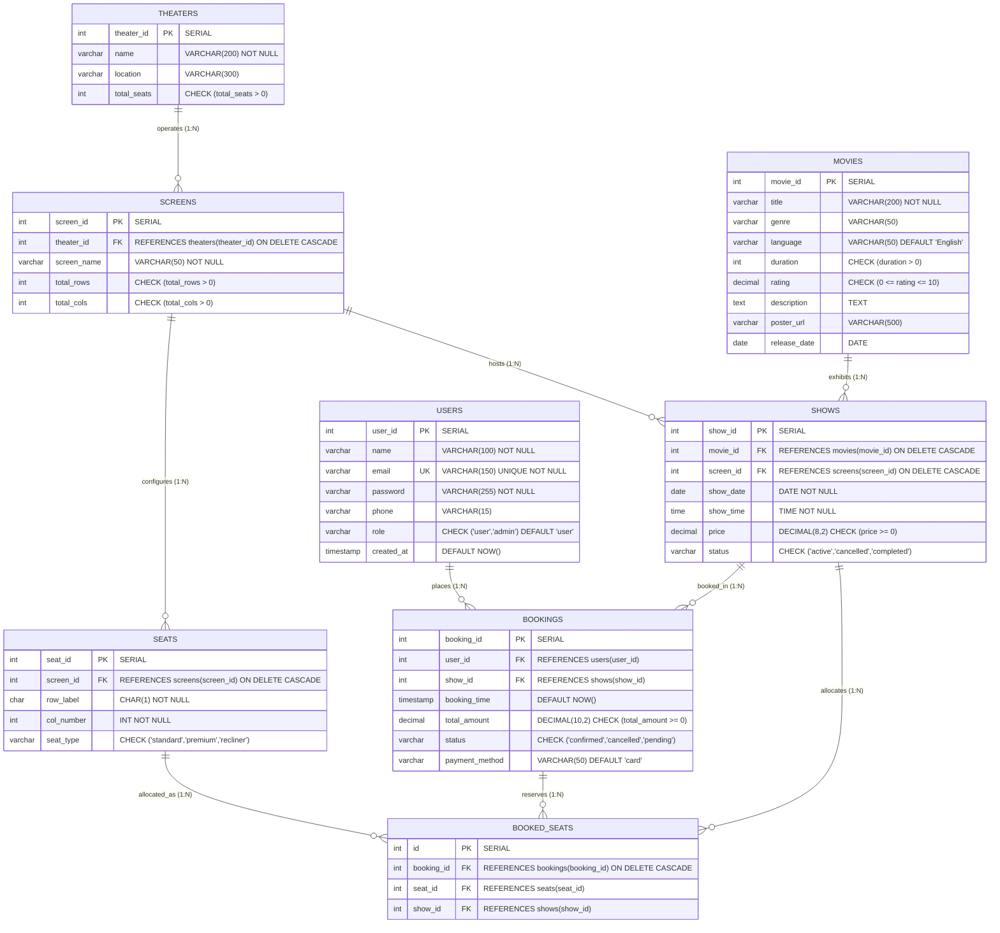

# CineBook — Cinema Ticket Booking System | DBMS Course Project


## Live Deployment & Project Links

- **Production URL:** [https://cinebook-pfef.onrender.com](https://cinebook-pfef.onrender.com)
- **Database Server:** Managed PostgreSQL 16 hosted on **Render.com** 
- **Application Server:** Node.js + Express hosted on **Render.com**


> **Note for Course Evaluators:**  
> To see the actual API requests and database responses, open Chrome DevTools (F12 → Network tab) while using the site."
---

## Pre-Seeded Demo Accounts

The database comes pre-loaded with testing accounts:

| Role | Email Address | Password | Permissions |
|---|---|---|---|
| **Admin** | `admin@movies.com` | `password` | Full access to Admin Dashboard, metrics, catalog CRUD, screen generator, and show scheduler |
| **Customer** | `alice@example.com` | `password` | Can browse movies, view seat maps, book tickets, and cancel reservations |
| **Customer** | `bob@example.com` | `password` | Independent user account for testing concurrent seat reservation flows |
| **Customer** | `carol@example.com` | `password` | Additional user account |

---

## Table of Contents
1. [Summary](#-summary)
2. [Entity-Relationship (ER) Diagram](#-entity-relationship-er-diagram)
3. [Database Relational Schema (3NF)](#-database-relational-schema-3nf)
4. [PostgreSQL Views](#-postgresql-views)
5. [Database Indexes & Performance Tuning](#-database-indexes--performance-tuning)
6. [REST API Reference](#-rest-api-reference)
7. [Repository Directory Structure](#-repository-directory-structure)
8. [Local Development & Setup Guide](#-local-development--setup-guide)
9. [Frontend Architecture Note](#-frontend-architecture-note)

---

##  Summary

To demonstrate mastery over relational database fundamentals, CineBook avoids abstraction layers such as Prisma, TypeORM, or Sequelize. Instead, it interacts directly with PostgreSQL via the low-level `pg` client driver. This ensures:
- Full manual control over **Transaction Control Language (TCL)** statements (`BEGIN`, `COMMIT`, `ROLLBACK`).
- Direct implementation of **Pessimistic Row-Level Locking** using `SELECT ... FOR UPDATE`.
- Mathematical adherence to **Third Normal Form (3NF)** across 8 tables.
- Complex relational aggregations materialized via **PostgreSQL Views** (`ARRAY_AGG`, `COUNT`, `LEFT JOIN`).
- Strict enforcement of declarative integrity constraints (**Primary Keys**, **Foreign Keys with `ON DELETE CASCADE`**, **Composite Unique Constraints**, and **Domain `CHECK` Constraints**).

```
+-------------------------------------------------------------+
|              Client Layer (Vanilla HTML5/CSS/JS)            |
+-------------------------------------------------------------+
                              | JSON over HTTPS
                              v
+-------------------------------------------------------------+
|               Express API Server (Node.js runtime)          |
|    - JWT Verification Middleware                            |
|    - Request Validation & Parameter Sanitization            |
+-------------------------------------------------------------+
                              | Parameterized SQL ($1, $2)
                              v
+-------------------------------------------------------------+
|             PostgreSQL Connection Pool (Max 20)             |
+-------------------------------------------------------------+
                              | Dedicated Client / Transaction
                              v
+-------------------------------------------------------------+
|              PostgreSQL 16 Relational Engine                |
|  - 8 Normalized Tables in 3NF                               |
|  - Row-Level Locking (Pessimistic Concurrency Control)       |
|  - Relational Views (show_availability, booking_details)    |
|  - B-Tree Secondary Indexes                                 |
|  - Write-Ahead Logging (WAL) for ACID Durability            |
+-------------------------------------------------------------+
```

---

## Entity-Relationship (ER) Diagram

The database consists of **8 relational tables** designed to eliminate insertion, update, and deletion anomalies while enforcing strict referential integrity.



---

## Database Relational Schema (3NF)

### 1. `users` Table
Stores customer credentials, contact details, and role-based permissions.
```sql
CREATE TABLE users (
    user_id     SERIAL PRIMARY KEY,
    name        VARCHAR(100) NOT NULL,
    email       VARCHAR(150) UNIQUE NOT NULL,
    password    VARCHAR(255) NOT NULL,
    phone       VARCHAR(15),
    role        VARCHAR(10) DEFAULT 'user' CHECK (role IN ('user', 'admin')),
    created_at  TIMESTAMP DEFAULT NOW()
);
```
- **Primary Key:** `user_id` (auto-incrementing surrogate key).
- **Constraints:** `email` is enforced `UNIQUE` to prevent duplicate identities. `role` enforces valid access levels via `CHECK`.
- **Security:** Passwords are never stored in plaintext; they store salted 60-character bcrypt hash strings.

---

### 2. `movies` Table
Stores movie metadata independent of theaters or schedules.
```sql
CREATE TABLE movies (
    movie_id     SERIAL PRIMARY KEY,
    title        VARCHAR(200) NOT NULL,
    genre        VARCHAR(50),
    language     VARCHAR(50) DEFAULT 'English',
    duration     INT NOT NULL CHECK (duration > 0),  -- duration in minutes
    rating       DECIMAL(3,1) CHECK (rating >= 0 AND rating <= 10),
    description  TEXT,
    poster_url   VARCHAR(500),
    release_date DATE
);
```
- **Primary Key:** `movie_id`.
- **Constraints:** `duration > 0` prevents nonsensical film lengths; `rating` is bounded between `0.0` and `10.0`.

---

### 3. `theaters` Table
Represents physical cinema locations.
```sql
CREATE TABLE theaters (
    theater_id  SERIAL PRIMARY KEY,
    name        VARCHAR(200) NOT NULL,
    location    VARCHAR(300),
    total_seats INT NOT NULL CHECK (total_seats > 0)
);
```
- **Primary Key:** `theater_id`.
- **Normalization note:** Isolating theaters from screens ensures a 1:N hierarchy (one theater contains many screens).

---

### 4. `screens` Table
Represents auditoriums within a theater, each with its own grid dimension.
```sql
CREATE TABLE screens (
    screen_id   SERIAL PRIMARY KEY,
    theater_id  INT NOT NULL REFERENCES theaters(theater_id) ON DELETE CASCADE,
    screen_name VARCHAR(50) NOT NULL,
    total_rows  INT NOT NULL CHECK (total_rows > 0),
    total_cols  INT NOT NULL CHECK (total_cols > 0)
);
```
- **Foreign Key:** `theater_id` references `theaters(theater_id)` with `ON DELETE CASCADE` (deleting a theater automatically purges its screens).
- **Capacity Calculation:** Auditorium physical seat count equals `total_rows * total_cols`.

---

### 5. `seats` Table
Contains physical seat coordinates generated for each screen.
```sql
CREATE TABLE seats (
    seat_id    SERIAL PRIMARY KEY,
    screen_id  INT NOT NULL REFERENCES screens(screen_id) ON DELETE CASCADE,
    row_label  CHAR(1) NOT NULL,
    col_number INT NOT NULL,
    seat_type  VARCHAR(20) DEFAULT 'standard' CHECK (seat_type IN ('standard', 'premium', 'recliner')),
    UNIQUE (screen_id, row_label, col_number)
);
```
- **Foreign Key:** `screen_id` references `screens(screen_id)` with `ON DELETE CASCADE`.
- **Composite Unique Key:** `UNIQUE (screen_id, row_label, col_number)` guarantees that physical duplicate coordinates (e.g., two seats labeled `A-5` in Screen 1) can never exist at the database level.
- **Seat Categorization:** `seat_type` domain constraint supports tiered cinema experiences.

---

### 6. `shows` Table
The central schedule table mapping a movie to a specific screen at an exact date and time.
```sql
CREATE TABLE shows (
    show_id    SERIAL PRIMARY KEY,
    movie_id   INT NOT NULL REFERENCES movies(movie_id) ON DELETE CASCADE,
    screen_id  INT NOT NULL REFERENCES screens(screen_id) ON DELETE CASCADE,
    show_date  DATE NOT NULL,
    show_time  TIME NOT NULL,
    price      DECIMAL(8,2) NOT NULL CHECK (price >= 0),
    status     VARCHAR(20) DEFAULT 'active' CHECK (status IN ('active', 'cancelled', 'completed'))
);
```
- **Foreign Keys:** `movie_id` and `screen_id` with `ON DELETE CASCADE`.
- **Financial Integrity:** `price` is declared as `DECIMAL(8,2)` with a `CHECK (price >= 0)` constraint, preventing floating-point imprecision errors common in `FLOAT` or `REAL` types.

---

### 7. `bookings` Table
Master ledger storing high-level ticket orders placed by users.
```sql
CREATE TABLE bookings (
    booking_id     SERIAL PRIMARY KEY,
    user_id        INT NOT NULL REFERENCES users(user_id),
    show_id        INT NOT NULL REFERENCES shows(show_id),
    booking_time   TIMESTAMP DEFAULT NOW(),
    total_amount   DECIMAL(10,2) NOT NULL CHECK (total_amount >= 0),
    status         VARCHAR(20) DEFAULT 'confirmed' CHECK (status IN ('confirmed', 'cancelled', 'pending')),
    payment_method VARCHAR(50) DEFAULT 'card'
);
```
- **Foreign Keys:** `user_id` references `users(user_id)`; `show_id` references `shows(show_id)`.
- **Audit Trail:** Preserves the user ID and timestamp (`NOW()`) when the transaction commits.

---

### 8. `booked_seats` Table
Granular associative entity linking individual seats to bookings for a specific show.
```sql
CREATE TABLE booked_seats (
    id         SERIAL PRIMARY KEY,
    booking_id INT NOT NULL REFERENCES bookings(booking_id) ON DELETE CASCADE,
    seat_id    INT NOT NULL REFERENCES seats(seat_id),
    show_id    INT NOT NULL REFERENCES shows(show_id),
    UNIQUE (seat_id, show_id)  -- Core database-level anti-double-booking constraint
);
```
- **Foreign Keys:** `booking_id` references `bookings(booking_id)` with `ON DELETE CASCADE`; `seat_id` and `show_id` reference `seats` and `shows`.
- **Critical Composite Constraint:** `UNIQUE (seat_id, show_id)`  
  > **Crucial Anti-Race Condition Guard:** Even if two concurrent application threads somehow bypass application-level checks, PostgreSQL will enforce serializability at the storage engine level and reject the second insert with error `23505 (unique_violation)`.

---


## Database Indexes & Performance Tuning

To avoid costly Sequential Scans (`Seq Scan`) across high-frequency lookup paths and foreign keys, 6 explicit B-tree indexes were engineered:

```sql
CREATE INDEX idx_shows_movie       ON shows(movie_id);
CREATE INDEX idx_shows_date        ON shows(show_date);
CREATE INDEX idx_booked_seats_show ON booked_seats(show_id);
CREATE INDEX idx_bookings_user     ON bookings(user_id);
CREATE INDEX idx_bookings_show     ON bookings(show_id);
CREATE INDEX idx_seats_screen      ON seats(screen_id);
```

| Index Name | Indexed Column | Index Type | Query Optimization Target |
|---|---|---|---|
| `idx_shows_movie` | `shows(movie_id)` | B-Tree | Accelerates showtime lookups when a user clicks on a movie. |
| `idx_shows_date` | `shows(show_date)` | B-Tree | Optimizes date-filtered schedule lookups (`show_date >= CURRENT_DATE`). |
| `idx_booked_seats_show` | `booked_seats(show_id)` | B-Tree | Accelerates seat map availability checks and `show_availability` view execution. |
| `idx_bookings_user` | `bookings(user_id)` | B-Tree | Speeds up the "My Bookings" user profile history query. |
| `idx_bookings_show` | `bookings(show_id)` | B-Tree | Speeds up administrative joins and audits per scheduled screening. |
| `idx_seats_screen` | `seats(screen_id)` | B-Tree | Eliminates table scans when populating screen seating matrices. |

> **DBMS Principle:** PostgreSQL automatically indexes primary keys and unique columns. However, foreign keys are **not** indexed by default. Indexing foreign keys prevents full-table locks during parent table deletions and transforms join operations from $O(N)$ sequential scans to $O(\log N)$ index scans.

---

## REST API Reference

All protected endpoints require an `Authorization: Bearer <JWT>` header.

| Method | Endpoint | Auth | Description |
|---|---|---|---|
| `POST` | `/api/auth/register` | Public | Registers a new user account |
| `POST` | `/api/auth/login` | Public | Authenticates credentials and returns a 7-day JWT |
| `GET` | `/api/movies` | Public | Lists movies with optional `?genre=` and `?search=` filters |
| `GET` | `/api/movies/genres` | Public | Retrieves all distinct movie genres |
| `GET` | `/api/movies/:id` | Public | Retrieves details for a specific movie |
| `GET` | `/api/movies/:id/shows` | Public | Shows for a movie with theater details & available seats |
| `GET` | `/api/shows/:id` | Public | Retrieves show metadata and capacity |
| `GET` | `/api/shows/:id/seats` | Public | Returns complete seat matrix marked as booked/available |
| `POST` | `/api/bookings` | User | **Creates a new booking (ACID transaction + row locking)** |
| `GET` | `/api/bookings/my` | User | Retrieves booking history for the authenticated user |
| `GET` | `/api/bookings/:id` | User/Admin | Retrieves receipt details for a single booking |
| `DELETE` | `/api/bookings/:id` | User/Admin | **Cancels an upcoming booking (transaction)** |
| `GET` | `/api/admin/stats` | Admin | Fetches analytical metrics and top 5 grossing movies |
| `GET` | `/api/admin/bookings` | Admin | Lists all bookings across the entire system |
| `POST` | `/api/admin/movies` | Admin | Adds a new movie to the catalog |
| `PUT` | `/api/admin/movies/:id` | Admin | Updates movie metadata |
| `DELETE` | `/api/admin/movies/:id` | Admin | Removes a movie (cascades to shows) |
| `GET` | `/api/admin/theaters` | Admin | Lists all theaters and screen counts |
| `POST` | `/api/admin/theaters` | Admin | Creates a new cinema theater |
| `POST` | `/api/admin/screens` | Admin | Adds screen and **auto-generates physical seats** |
| `POST` | `/api/admin/shows` | Admin | Schedules a show with **screen conflict detection** |
| `PUT` | `/api/admin/shows/:id/cancel`| Admin | Cancels a scheduled show |

---

## Repository Directory Structure

```
cinebook/
├── backend/
│   ├── index.js              # Express application bootstrap & static serving
│   ├── db.js                 # PostgreSQL connection pool configuration
│   ├── package.json          # Node.js dependencies (pg, express, bcrypt, jsonwebtoken)
│   ├── .env.example          # Environment configuration template
│   ├── middleware/
│   │   └── auth.js           # JWT authentication & role-based access verification
│   └── routes/
│       ├── auth.js           # Register & login authentication logic
│       ├── movies.js         # Movie catalog & showtime discovery
│       ├── shows.js          # Show details & seat availability mapping
│       ├── bookings.js       # Transactional booking & cancellation engine
│       └── admin.js          # Analytics, CRUD operations & screen generation
├── database/
│   ├── schema.sql            # Complete DDL: 8 tables, 6 indexes, 2 views, constraints
│   └── seed.sql              # DML: Sample theaters, screens, 80+ seats, movies, shows
├── frontend/
│   ├── index.html            # Movie discovery homepage with search & filters
│   ├── movie.html            # Movie synopsis & scheduled showtimes
│   ├── seats.html            # Real-time interactive seat selection grid
│   ├── confirm.html          # Booking confirmation and invoice view
│   ├── mybookings.html       # Customer reservation history & cancellation
│   ├── auth.html             # User login & registration portal
│   ├── admin.html            # Administrative control center & live analytics
│   ├── css/
│   │   └── style.css         # Dark theme cinema styling
│   └── js/
│       ├── api.js            # Fetch wrapper with JWT injection & error handling
│       └── auth.js           # Client-side session state & navigation bar manager
└── README.md                 # Complete DBMS project documentation
```

---

## Local Development & Setup Guide

> **Note:** The system is already live at [https://cinebook-pfef.onrender.com](https://cinebook-pfef.onrender.com). If you wish to run the project locally, follow the steps below.

### 1. Prerequisites
- **Node.js** (v18.0.0 or higher)
- **PostgreSQL** (v14.0 or higher)

### 2. Database Initialization
Create a local database and execute the schema and seed scripts:

```bash
# Create PostgreSQL database
createdb movie_booking

# Execute schema (tables, constraints, views, indexes)
psql -d movie_booking -f database/schema.sql

# Seed initial movies, theaters, screens, and demo accounts
psql -d movie_booking -f database/seed.sql
```

### 3. Backend Configuration
Navigate to the backend directory and configure the environment variables:

```bash
cd backend
cp .env.example .env
```

Update `.env` with your local database credentials:
```env
PORT=5000
DB_HOST=localhost
DB_PORT=5432
DB_NAME=movie_booking
DB_USER=postgres
DB_PASSWORD=your_password
JWT_SECRET=super_secret_jwt_key_for_testing
```

### 4. Install Dependencies & Launch
```bash
# Install dependencies
npm install

# Run in development mode (with auto-reload)
npm run dev

# Or run in standard production mode
npm start
```

Access the application in your browser at `http://localhost:5000`.

---


### Academic Evaluation Checklist
- [x] **Relational Modeling:** 8 tables structured cleanly in **3NF** with zero partial or transitive dependencies.
- [x] **ACID Transactions:** Full manual `BEGIN`, `COMMIT`, and `ROLLBACK` handling in `backend/routes/bookings.js`.
- [x] **Concurrency & Race Conditions:** Pessimistic row locking via `SELECT ... FOR UPDATE` and database-level `UNIQUE` constraints.
- [x] **Relational Views:** Dynamic computation via `show_availability` and complex 7-table join via `booking_details`.
- [x] **Performance Optimization:** 6 explicit B-tree secondary indexes for foreign keys and range lookups.
- [x] **Advanced SQL Techniques:** Subquery aggregations, set-returning functions (`generate_series`), Cartesian products (`CROSS JOIN`), `ARRAY_AGG()`, and interval arithmetic.
- [x] **Security & Integrity:** 100% parameterized queries eliminating SQL injection; multi-tier `CHECK` and `CASCADE` constraints.
- [x] **Production Deployment:** Live cloud deployment with PostgreSQL database hosted on Render.com.
